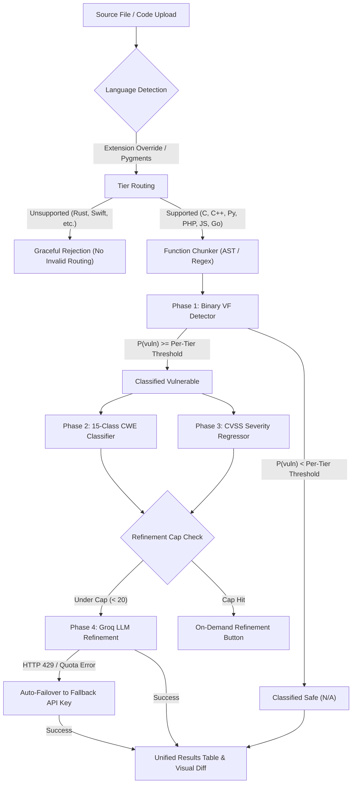

# SecuraX — Phase 5: Pipeline Integration & Streamlit UI Documentation

**Phase:** Phase 5 — Pipeline Integration & Interactive User Interface  
**Status:** ✅ **COMPLETE**  
**Execution Machine:** macOS, Linux, or Windows (Local PyTorch + PEFT models on CPU/MPS/CUDA; Groq API for Refinement)  
**Launch Command:** `streamlit run app/main.py`  

---

## 1. Executive Summary

Phase 5 unifies all previous project phases into an end-to-end vulnerability intelligence and code repair system:
- **Phase 0.5 Tiering & Pygments Language Routing:** Directs incoming source files to the appropriate model tier without cross-tier contamination.
- **Phase 1 Multi-Tier Binary Detection:** Evaluates function chunks with calibrated decision thresholds ($0.10$ to $0.70$).
- **Phase 2 15-Class CWE Classification:** Categorizes weaknesses into MITRE semantic groups.
- **Phase 3 CVSS Severity Scoring:** Predicts continuous exploitability impact scores ($0.0$ to $10.0$).
- **Phase 4 Automated Code Refinement:** Calls Groq's high-speed inference engine (`qwen/qwen3.8-27b`) with on-disk SHA-256 caching and an automatic multi-key failover pool.
- **Streamlit Web Dashboard:** Provides interactive file upload, function-level AST chunking, unified diff inspection, and quota cap management.

---

## 2. End-to-End Pipeline Architecture



---

## 3. Supported Languages & Tier Mappings

Languages are dynamically resolved from [`data/processed/manifest.json`](data/processed/manifest.json):

| Tier | Language | File Extensions | Phase 1 Winner | Threshold | Phase 2 Model | Phase 3 Model |
|---|---|---|---|:---:|---|---|
| **Tier 1** | **C** | `.c`, `.h` | GraphCodeBERT + LoRA | **0.70** | Calibrated Ensemble / GCB-v2 | CodeT5 Regressor |
| **Tier 2** | **C++** | `.cpp`, `.hpp`, `.cc`, `.cxx` | GraphCodeBERT + LoRA | **0.10** | GraphCodeBERT-v2 | GraphCodeBERT Regressor |
| **Tier 2** | **Python** | `.py`, `.pyw` | GraphCodeBERT + LoRA | **0.15** | GraphCodeBERT-v2 | GraphCodeBERT Regressor |
| **Tier 2** | **PHP** | `.php`, `.phtml` | CodeT5 + LoRA | **0.10** | CodeT5-v2 | CodeT5 Regressor |
| **Tier 3** | **Shared** (Go, Java, JS, TS, Ruby, JSON) | `.go`, `.java`, `.js`, `.ts`, `.rb`, `.json` | CodeT5 + LoRA + `<LANG>` | **0.50** | CodeT5-v2 | CodeT5 Regressor |

> **Unsupported Languages Guard:** Languages without trained model tiers (e.g., Rust, Shell, Swift, Kotlin, Perl, SQL) are rejected with a clear message: `"Language '{lang}' is not supported. Supported languages: C, C++, Python, PHP, Go, Java, JavaScript, Ruby, TypeScript"`. They are **never** routed to an arbitrary tier.

---

## 4. Standard Results Schema

The pipeline and Streamlit dashboard output table strictly conforms to the required specification:

```
PL | Snippet | VF | CWE-id | Refined Code | LOC | Severity Score
```

### Cell Field Definitions:
- **`PL`**: Detected canonical language (e.g. `C`, `Python`, `PHP`, `JavaScript`).
- **`Snippet`**: Extracted function identifier (e.g. `parse_payload()`, `authenticate_user()`).
- **`VF`**: Binary status (`"Vulnerable"` or `"Safe"`).
- **`CWE-id`**: Predicted weakness class (e.g. `CWE-119` or `"N/A (Safe)"`).
- **`Refined Code`**: Complete generated secure patch, or `"Refinement unavailable: <reason>"`, or `"N/A (Code is Safe)"`.
- **`LOC`**: Non-empty, non-comment lines of code in the function chunk.
- **`Severity Score`**: Continuous CVSS score (e.g. `7.5 / 10.0`) or `"N/A"`.

---

## 5. UI Features & Controls

The Streamlit web application ([`app/main.py`](app/main.py)) includes:

1. **Flexible Ingestion:**
   - Drag-and-drop file uploader supporting `.c`, `.cpp`, `.py`, `.php`, `.js`, `.ts`, `.go`, `.java`, etc.
   - Direct code paste text editor.
   - Curated real-world vulnerable examples dropdown for immediate live testing.
2. **Quota Cap Management:**
   - Adjustable slider (default: `20` refinements per upload, range `1` to `50`) to protect Groq free-tier rate limits.
   - For files with high vulnerability counts exceeding the cap, snippets display a notice and provide an interactive **"Refine on Demand"** button.
3. **Interactive Unified Diffs:**
   - Color-coded syntax-highlighted side-by-side view comparing original vulnerable code with the generated patch.
4. **Secret Handling & Resilience Status:**
   - API keys are read from environment / `.env` / `st.secrets` and **never displayed** in UI or logs.
   - Sidebar displays live API status, active key pool count, and response cache telemetry.

---

## 6. Edge Cases Handled

| Edge Case | Detection Mechanism | System Behavior |
|---|---|---|
| **Empty File / Code** | String strip length check | Halts before pipeline runs; displays informative warning. |
| **Binary Executable** | Scans first 1,024 bytes for `\x00` null bytes | Rejects upload immediately with explicit notice. |
| **Oversized Function (>3.5k chars)** | Prompt truncation guard | Slices code safely at 3,500 chars with notification comment to prevent HTTP 413 / ITPM token ceiling breaches. |
| **Missing API Key** | `GroqRefinementClient.is_available == False` | Pipeline executes Phases 1–3 normally; Refined Code cell displays `"Refinement unavailable: GROQ_API_KEY is not set"`. |
| **HTTP 429 / Credits Exhausted** | `is_quota_or_rate_limit_error()` | Automatically transfers request in-flight to fallback key in pool; if all busy, applies exponential backoff with jitter. |
| **Malformed LLM Output** | Robust multi-regex parser | Handles unclosed code fences, multiple markdown blocks, or raw code without syntax failure. |

---

## 7. Known Limitations (Documented Constraint Exception)

1. **Hosted API Dependency:** Automated code refinement (Phase 4) depends on Groq's cloud infrastructure. Unlike Phases 1–3 which run 100% locally on PyTorch, code snippets are transmitted over HTTPS to Groq's LPUs.
2. **Rate Limits & Token Ceilings:** Groq free-tier enforces 1,000 output tokens per minute (OTPM) and 7,000 input tokens per minute (ITPM) on on-demand tiers. Mitigated via client-side throttling (30 RPM), SHA-256 caching, multi-key failover, and snippet length guards.
3. **Third-Party Data Exposure:** Proprietary or confidential code should not be submitted to cloud-hosted free-tier APIs without mentor and institutional approval. Offline local fallback is available via Ollama (Phase 7 stretch option).

