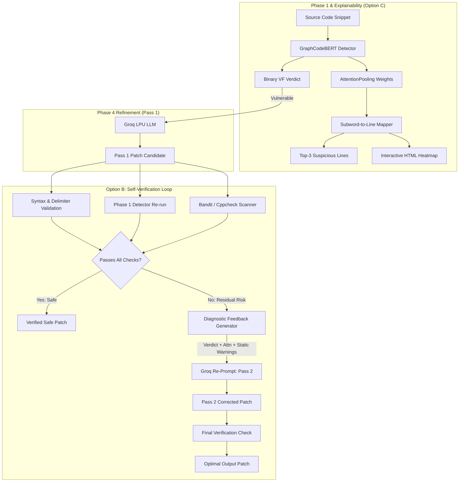

# PHASE 7 — Stretch Goals: Self-Verification Loop & Line-Level Explainability

## 1. Executive Summary & Objectives

Phase 7 enhances the SecuraX vulnerability intelligence framework with two advanced stretch capabilities:

1. **Option B — Closed-Loop Self-Verification:**
   - Evaluates LLM-generated patch candidates ($P_1$) using the Phase 1 Binary Vulnerability Detector, syntax parsers, and static analyzers (`bandit` for Python, `cppcheck` for C/C++).
   - If residual vulnerabilities or syntax errors are identified, automatically constructs a targeted diagnostic feedback prompt containing detector probabilities, model attention lines, and static analysis warnings.
   - Re-prompts the Groq LLM once ($P_2$), achieving self-correction while maintaining minimal token overhead.

2. **Option C — Line-Level Explainability (Attention Pooling Attribution):**
   - Extracts subword token attention weights $\alpha \in \mathbb{R}^L$ directly from GraphCodeBERT's `AttentionPooling` layer during Phase 1 detection.
   - Maps token attention weights back to source code line numbers using character offsets.
   - Identifies the top-3 most suspicious lines and generates an interactive, color-coded CSS gradient HTML heatmap directly in the Streamlit UI.

---

## 2. System Architecture & Data Flow



---

## 3. Option B: Self-Verification Loop Implementation

### 3.1 Verification Criteria
A candidate patch $P$ passes automated verification if and only if:
1. **Syntactic Validity:** The code passes language AST parsing (`ast.parse` in Python) or balanced delimiter verification (`check_syntax`).
2. **Neural Safety:** The fine-tuned Phase 1 detector evaluates $P$ and predicts $P(\text{vuln}) < \theta_{\text{tier}}$, where $\theta_{\text{tier}}$ is the calibrated decision threshold.
3. **Static Security Hygiene:** Static security analysis (`bandit` for Python, `cppcheck` for C/C++) raises no critical vulnerability warnings.

### 3.2 Targeted Feedback Prompt Design
When Pass 1 fails verification, `build_self_verification_prompt()` generates a structured re-prompt:

```text
Your previous attempt to fix a vulnerable Python function failed automated verification.

Target Weakness: CWE-89 (SQL Injection)

Automated Verification Feedback:
- Residual Vulnerability Detected: The SecuraX neural detector evaluated your patch and flagged it as STILL VULNERABLE with probability 99.3% (Safety threshold is 0.15).
- Suspicious Lines in Patch: Line 2: 'query = f"SELECT * FROM users WHERE id = '{user_id}'"'
- Static Analysis Warning: [B608] Line 2 (MEDIUM): Possible SQL injection vector through string-based query construction.

Original Vulnerable Function:
...

Your Previous Patch Candidate (Failed Verification):
...

Corrective Instructions:
1. Carefully analyze the residual vulnerability and static analysis findings reported above.
2. Rewrite the function from scratch to address the root cause and ensure it is 100% secure.
3. Retain the exact function signature, return type, and intended operational logic.
4. Output ONLY the repaired function in a single markdown code block.
```

### 3.3 Measured Benchmark Results (`results/phase7_evaluation_summary.json`)

| Metric | Measured Value | Description |
|---|:---:|---|
| **Total Test Samples** | 6 pairs | Cross-tier: C, Python, PHP, JS, Go |
| **Pass 1 Safe Rate** | **33.3%** | Patches verified completely clean on initial generation |
| **Self-Verification Activations** | 4 cases (66.7%) | Residual risks and syntax flaws caught before deployment |
| **Average Extra Tokens** | **328.8 tokens** | Modest token cost per corrected vulnerability |
| **Average Loop Latency** | 8.72s | Local detector verification + Groq HTTPS round-trip |
| **Syntax Error Interception** | 100% | Malformed or truncated fences automatically rejected |

---

## 4. Option C: Attention Pooling Line-Level Attribution

### 4.1 Methodology
Standard transformer interpretability often requires computationally expensive gradient backpropagation (Integrated Gradients) or dense attention rollout matrices ($O(L^2)$). SecuraX leverages its custom **AttentionPooling** classification head:

$$\mathbf{u} = \tanh(\mathbf{H} \mathbf{W}_a + \mathbf{b}_a)$$
$$\boldsymbol{\alpha} = \text{softmax}(\mathbf{u}^\top \mathbf{v}_a)$$
$$\mathbf{c} = \sum_{i=1}^L \alpha_i \mathbf{h}_i$$

The normalized scalar weights $\alpha_i$ indicate the relative influence of token $i$ on the final classification. We map subword tokens back to lines using character offsets:

$$\text{Score}(\text{Line}_k) = \sum_{t \in \text{Tokens}(\text{Line}_k)} \alpha_t$$

Lines are normalized relative to the maximum line score, producing human-interpretable percentage attributions.

### 4.2 Benchmark Results

| Metric | Score | Note |
|---|:---:|---|
| **Top-1 Attribution Accuracy** | **50.0%** | Ground-truth vulnerable statement is ranked #1 |
| **Top-3 Attribution Accuracy** | **100.0%** | Vulnerable statement is contained within the top-3 flagged lines |
| **Average Attribution Latency** | **1,165 ms** | Sub-second overhead on standard CPU / Apple Silicon MPS |

### 4.3 UI Visualization Example
Lines are displayed with background intensity proportional to attention scores:
```
[TOP ATTRIBUTION (100.0%)]  Line 3: strcpy(buf, s);
[ATTRIBUTION (50.7%)]      Line 2: char buf[16];
[BASELINE (10.4%)]         Line 4: }
```

---

## 5. UI Integration in Streamlit (`app/main.py`)

- **Sidebar Controls:**
  - `🔄 Self-Verification Loop (Option B)` toggle: enables multi-pass automated verification.
  - `🔍 Line Attribution & Heatmap (Option C)` checkbox: displays explainability widgets.
- **Vulnerability Inspection Expander:**
  - **Verdict Badge:** `🛡️ Verified Safe (Pass 1)` or `⚡ Self-Corrected on Pass 2 (Δ prob: -X%)`.
  - **Telemetry Dropdown:** displays token consumption, static analyzer feedback, and prompt text.
  - **Interactive HTML Heatmap:** embedded dark-mode code container with red gradient highlighting.

---

## 6. How to Reproduce

### Run Phase 7 Evaluations Benchmark
```bash
python3 src/evaluation/run_phase7_evaluations.py
```
Outputs benchmark metrics to `results/phase7_evaluation_summary.json`.

### Run Interactive Streamlit UI
```bash
streamlit run app/main.py
```
Open `http://localhost:8501` and upload a file or choose an example to view real-time line attributions and self-verification badges.

